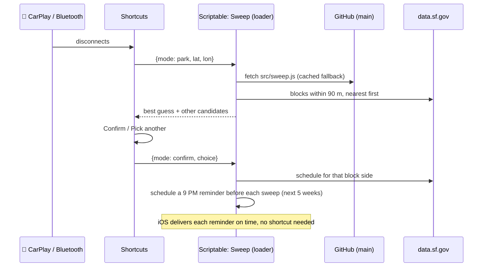

# 🧹 sf-street-sweeper

**Never get a San Francisco street-sweeping ticket again.** When you park, your iPhone works out which block and which side of the street you're on, looks up that side's sweeping schedule, and reminds you to move the car at 9 PM the night before each sweep.

| When | What you see |
|---|---|
| 🚗 You park (Sat 2:00 PM) | **Confirm Parking Location**<br>📍 Folsom St, Near 22nd St, West side<br>✅ Confirm · ✏️ Pick another · 🚫 Not now |
| 🌙 Night before (Sun 9:00 PM) | **Car Move Reminder**<br>Located at Folsom St, Near 22nd St, West side<br>Street sweeping Mon, Oct 26, 9:00 AM–11:00 AM. |

Built with **Apple Shortcuts** for the triggers and menus, **[Scriptable](https://scriptable.app)** for the logic, and SF's **[Street Sweeping Schedule](https://data.sf.gov/d/yhqp-riqs)** open data.

---

## How it works



- **Which block:** one Socrata query using `distance_in_meters()` returns the nearest block sides, already sorted.
- **Which side:** a cross product of your position against the block's centreline gives left/right, which maps to the dataset's `cnnrightleft`. The `blockside` field gives the compass label (North, West, …).
- **Which cross street:** where your position falls along the block (`limits` is listed in the line's drawn direction) gives the nearer end.
- **The pick-another list:** up to 10 distinct *street, cross street, side* options. Nearby blocks come first, then each block's far end, in case GPS is off along the block.
- **When:** `weekN` means the Nth occurrence of that weekday in the month. On confirm, the script finds every sweep in the next 36 days and schedules a 9 PM reminder the night before each one (up to 20). That's far beyond SF's 72-hour parking limit, so nothing needs to run nightly. If you park after 9 PM the night before, that reminder is sent immediately.
- **Cancelling:** parking again, or reconnecting to the car, cancels every pending reminder and forgets the spot. Outside SF the API returns nothing, so nothing is set.

> **About GPS accuracy:** phone GPS is usually off by 5–15 m, about half a street's width. The street and cross street are reliable; the side is a best guess. That's why you're asked to confirm.

---

## Setup

### 1. Publish this repo
Push it to GitHub. The phone fetches `src/sweep.js` anonymously, so the repo needs to be **public** (see [Private repos](#private-repos) otherwise).

### 2. Install the loader in Scriptable
1. Install [Scriptable](https://apps.apple.com/app/scriptable/id1405459188) on your iPhone.
2. Create a script named **`Sweep`** and paste in [`scriptable/Sweep.js`](scriptable/Sweep.js).
3. `REPO` at the top is set to `tclare/sf-street-sweeper`. Change it if you fork this repo.

That's the only code that lives on the phone. Everything else comes from `main`.

### 3. Build the Shortcuts
In each **Run Script** action, choose script *Sweep* and leave **Run In App** off.

<details open>
<summary><b>Sweep · Clear</b></summary>

1. **Run Script** · Parameter: **Dictionary** `mode = clear`
</details>

<details open>
<summary><b>Confirm Parking Location</b> (iOS titles the menu notification with this name)</summary>

1. **Run Shortcut** `Sweep · Clear`
2. **Get Current Location**
3. **Run Script** · Parameter: **Dictionary** `mode = park`, `lat = Current Location › Latitude`, `lon = Current Location › Longitude`
4. **If** *Script Result › best* does not have any value → **Stop This Shortcut**
5. **Choose from Menu** · Prompt: *Script Result › prompt*
   - **✅ Confirm**: **Text** *Script Result › best* → **Set Variable** `Choice`
   - **✏️ Pick another**: **Choose from List** *Script Result › labels* → **Set Variable** `Choice`
   - **🚫 Not now**: **Stop This Shortcut**
6. **Run Script** · Parameter: **Dictionary** `mode = confirm`, `choice = Choice`
</details>

<details open>
<summary><b>Sweep · Status</b> (optional: what's being tracked, for Siri, widgets or other shortcuts)</summary>

1. **Run Script** · Parameter: **Dictionary** `mode = status`
2. **Get Dictionary Value** `text` in *Script Result*
3. **Stop and Output** *Dictionary Value*

The output is empty when no confirmed spot has reminders scheduled. To see it when you tap the shortcut, put **If** *Dictionary Value* has any value → **Show Result** before step 3.
</details>

### 4. Add the automations (on the iPhone)
Shortcuts › Automation › **+**. Choose **Run Immediately** for each and turn off *Notify When Run*.

| Trigger | Runs |
|---|---|
| CarPlay **Disconnects** (or Bluetooth › *your car* › Disconnects) | `Confirm Parking Location` |
| CarPlay **Connects** | `Sweep · Clear` |

Allow Shortcuts location access as **Always**.

---

## Script interface

`src/sweep.js` exports `run(input)`. The Shortcuts parameter dictionary is passed straight through.

| `mode` | Input | Returns |
|---|---|---|
| `park` | `lat`, `lon` | `{best, prompt, labels}`, or `{labels: []}` outside SF |
| `confirm` | `choice` (one of `labels`) | `{spot, next, reminders}`: the next sweep and how many reminders were scheduled |
| `clear` | — | `{}` (cancels all reminders, forgets the spot) |
| `status` | — | `{text}`: spot, next sweep and reminder count on separate lines, or `""` when nothing is tracked |

Pass `now` (an ISO date) to pretend it's another time. This works in the Shortcuts Dictionary too, which is handy for testing on the phone. Tuning constants (`SEARCH_METERS`, `MAX_OPTIONS`, `NOTIFY_HOUR`, `LOOKAHEAD_DAYS`, `MAX_REMINDERS`) are at the top of the file.

The parameter can also be JSON text or a bare mode name (`clear`), and keys are matched case-insensitively. Input with no recognisable `mode` gives an error that shows what the script received.

**No input** (tapping ▶︎ in Scriptable) opens a read-only status screen: the version, your saved spot and next sweep, how many reminders are scheduled, and a live check of the SF API.

---

## Development

```sh
npm test               # all tests (offline schedule maths, loader fallback, live API scenarios)
npm run test:offline   # skip the tests that call data.sf.gov

npm run try -- park lat=37.7549 lon=-122.41448     # print what Shortcuts would get
npm run try -- confirm "choice=Folsom St, Near 22nd St, West side"
npm run try                                        # status
npm run try -- clear
```

`npm run try` runs the real script against the live API and remembers the saved spot in `.sweep-state/`, so park → confirm → status works across runs. Notifications are printed instead of sent. On the phone, add **Quick Look** (*Script Result*) after any Run Script action to see the same output.

Node 18+ is required; there are no dependencies. The tests run the real script against small stand-ins for Scriptable's `Request`, `Notification` and `FileManager` ([`test/scriptable-mock.js`](test/scriptable-mock.js)). They use `America/Los_Angeles` time so DST is covered.

### Shipping a change
Your phone runs **whatever is on `main`**. Commit, then push:

```sh
npm test && git push
```

- The loader fetches a fresh copy on every run, bypassing GitHub's cache.
- **Checking a deploy:** bump `VERSION` at the top of `src/sweep.js`, push, then tap ▶︎ on *Sweep* in Scriptable. The title should show the new version.
- **A broken push doesn't break your phone.** If the download fails, isn't HTTP 200, or doesn't load, the loader uses the last good copy. The same happens when you're offline.
- CI ([`.github/workflows/test.yml`](.github/workflows/test.yml)) runs the tests on every push, and weekly to catch changes to the SF dataset.
- **Pinning:** to stop the phone tracking `main`, set `REF` in the loader to a tag (`v1.0.0`) or commit SHA. Then release with `git tag v1.1.0 && git push --tags` and update `REF`.

### Private repos
`raw.githubusercontent.com` needs a token for private repos. Create a fine-grained token with read-only *Contents* access to this repo. Store it once in Scriptable with `Keychain.set("github-token", "...")`, then add this to the loader's request:

```js
req.headers = { Authorization: `token ${Keychain.get("github-token")}` };
```

---

## Known limitations

- **Holidays aren't checked.** You may get a reminder on a holiday when sweeping is suspended, which errs on the safe side.
- **Reminders are notifications, not alarms.** They follow silent mode and Focus.
- **Reminders cover 5 weeks.** A car left in one spot longer than that gets no further reminders, though SF's 72-hour limit applies long before then.
- **Data quirks.** A few SF records have truncated street names (`ission Bay Cir`) or leading zeros (`04th St`).
- **Maps' Parked Car pin isn't used.** Shortcuts can't read it. The automation uses the same CarPlay/Bluetooth disconnect signal Maps relies on, plus your current location.

## Data

[Street Sweeping Schedule](https://data.sf.gov/d/yhqp-riqs) · San Francisco Public Works / SFMTA, via DataSF (`data.sf.gov`; the old `data.sfgov.org` host redirects there).
